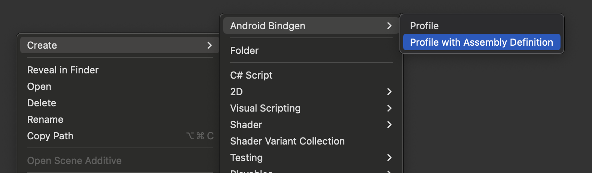
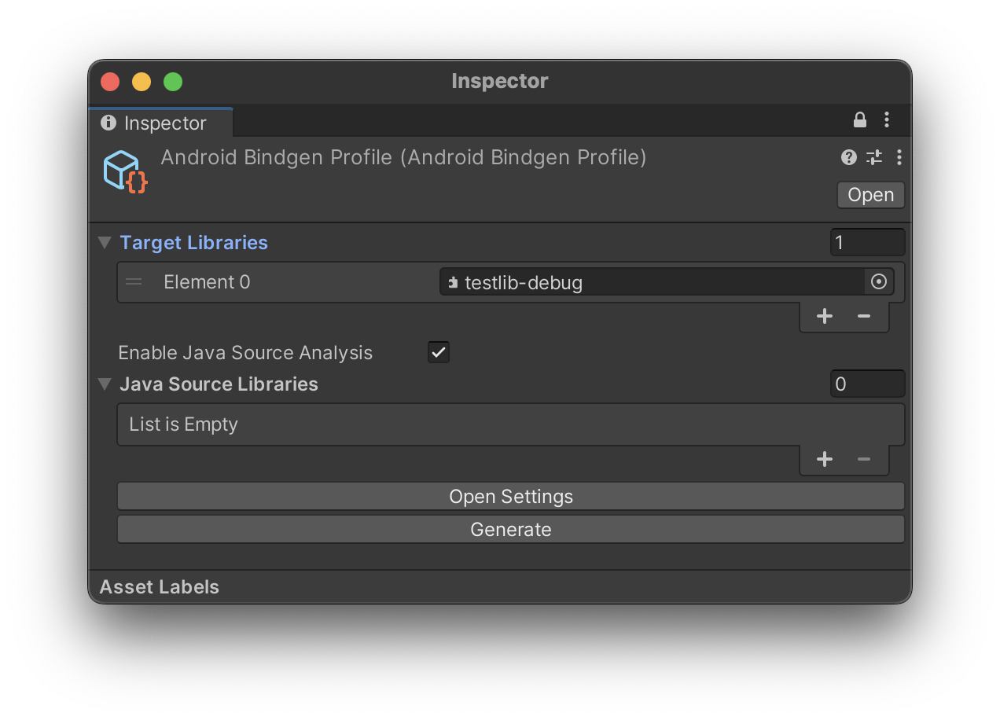
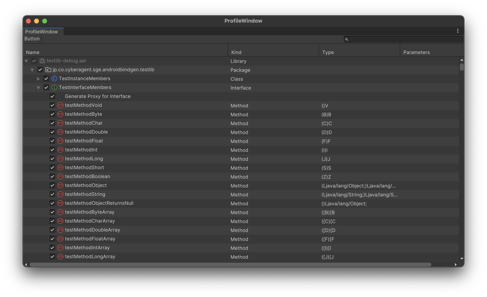

# AndroidBindgen

[](LICENSE)
[](https://github.com/CyberAgentGameEntertainment/AndroidBindgen/pulls)
[](#インストール)

[English](README.md)

Unity で Android (Java) のネイティブ呼び出しを行うバインディングを自動生成するツールです。  
`AndroidJavaObject` や `AndroidJavaProxy` を直接利用するよりもパフォーマンスの優れたコードを生成します。

<!-- TOC -->
* [AndroidBindgen](#androidbindgen)
  * [要件](#要件)
  * [インストール](#インストール)
    * [1. 依存関係のインストール](#1-依存関係のインストール)
    * [AndroidBindgen のインストール](#androidbindgen-のインストール)
  * [使い方](#使い方)
  * [生成されたバインディングについて](#生成されたバインディングについて)
    * [アップキャスト](#アップキャスト)
    * [ダウンキャスト](#ダウンキャスト)
    * [Proxy](#proxy)
  * [CLI からの自動生成](#cli-からの自動生成)
  * [ライセンス](#ライセンス)
<!-- TOC -->

## 要件

- Unity 2022.3 以降

## インストール

### 1. 依存関係のインストール

[NuGetForUnity](https://github.com/GlitchEnzo/NuGetForUnity) や [UnityNuGet](https://github.com/bdovaz/UnityNuGet) を使用して以下のパッケージをインストールします。

- [System.Runtime.CompilerServices.Unsafe](https://www.nuget.org/packages/system.runtime.compilerservices.unsafe/)

### 2. AndroidBindgen のインストール

以下の git URL を Package Manager に追加してください。

```
https://github.com/CyberAgentGameEntertainment/AndroidBindgen.git?path=AndroidBindgen.Unity/Packages/jp.co.cyberagent.android-bindgen#release
```

## 使い方

バインディングを生成するフォルダで `Create > Android Bindgen > Profile with Assembly Definition` を選択します。



生成された `AndroidBindgenProfile` の Inspector の **Target Libraries** 欄に、バインディングを生成したい `*.jar` あるいは `*.aar` を指定します。**対象のライブラリが別のライブラリに依存している場合は、それらも全て含めてください。**  
また、**Enable Java Source Analysis** を有効化すると、Javaのソースから Documentation Comment や 一部の引数の名前を取得することができます。**Java Source Libraries** 欄に Java ソースを含む `sources.jar` を指定してください。

> [!NOTE]
> `android.jar`, そのソースを含む `android-stubs-src.jar`, および Unity の `classes.jar` は、使用している Unity エディタにインストールされたものを自動的に選択するので、手動での指定は不要です。

> [!WARNING]
> Java ソース解析には Java が必要です。
> Java ソース解析には時間がかかるため、不要な場合は無効化してください。



次に `Open Settings` をクリックして Profile Window を開きます。このウィンドウでバインディングを生成する対象を選択します。

- メソッド: メソッドのバインディングを生成します。
- フィールド: フィールドのバインディングを生成します。
- `Generate Proxy for Interface`: インターフェースに対するプロキシを作成するための基底クラスを生成します。



> [!NOTE]
> `<init>` という名前のメソッドはコンストラクタを意味します。

選択できたら `Generate` をクリックしてバインディングを生成します。バインディングは `generated` フォルダ下に出力されます。このフォルダに含まれるファイルは自動的に削除・上書きされることがあるので注意してください。

## 生成されたバインディングについて

Java側のそれぞれの型に対してC#側ではバインディング用のインターフェースが生成されます。

コンストラクタからJavaオブジェクトを生成するには、それぞれのインターフェースに定義された静的メソッド`New`を使用します。

```cs
java.util.ArrayList list = java.util.ArrayList.New(10);
```

> [!NOTE]
> Java側のパッケージ名がそのままC#の名前空間に反映されます。
> 
また、外部のJNIオブジェクトポインタからバインディングオブジェクトのインスタンスを生成することもできます。

```cs
java.util.ArrayList list = java.util.ArrayList.FromRawObject(ptr);
```

さらに、メソッドの戻り値としてバインディングオブジェクトが返されることもあります。

```cs
java.lang.Object element = list.get(0);
```

> [!NOTE]
> ジェネリクスは型消去されているので、型パラメータはすべて`java.lang.Object`として扱われます。

これらの方法で取得したバインディングオブジェクトは`AndroidJavaObject`を継承しており、安全にキャストできます。

```cs
var list = java.util.ArrayList.New(10);
var obj = list as AndroidJavaObject;
```

### アップキャスト
バインディング用のインターフェースの継承関係は、Java側のクラス階層を反映しているので、安全なアップキャストが可能です。

```cs
java.util.ArrayList list = new java.util.ArrayList();
java.util.Cloneable cloneable = list;
```

### ダウンキャスト
バインディングオブジェクトはC#のダウンキャストができません。代わりに`FromRawObject()`を使用してください。

```cs
java.util.Cloneable cloneable = /* ... */;

// NG
// java.util.ArrayList list = (java.util.ArrayList) cloneable;
// java.util.ArrayList list = cloneable as java.util.ArrayList;

// OK
java.util.ArrayList list = java.util.ArrayList.FromRawObject(cloneable);
```

### Proxy

Java側のインターフェースに対してバインディング生成を行うと、Unity側で実装を行うためのプロキシ用基底クラス`ProxyBase`が生成されます。これを継承すると、必要なメンバを安全にオーバーライドして実装することができます。

```cs
using android.app;
using android.content;
using android.os;
using com.unity3d.player;
using UnityEngine;

private void Start()
{
    using var powerManagerObj = UnityPlayer.get_currentActivity().getSystemService(Context.get_POWER_SERVICE());
    using var powerManager = PowerManager.FromRawObject(powerManagerObj); // ダウンキャスト

    // プロキシの作成
    var listener = new ThermalStatusChangedListener();
    
    // 登録
    powerManager.addThermalStatusListener(listener);
}

// OnThermalStatusChangedListenerの実装
private class ThermalStatusChangedListener : PowerManager.OnThermalStatusChangedListener.ProxyBase
{
    public override void onThermalStatusChanged(int arg0)
    {
        Debug.Log($"Thermal status changed: {arg0}");
    }
}

```

> [!NOTE]
> 複数のインターフェースを同時に実装するプロキシの作成はサポートしていません。

## CLI からの自動生成

Unity を経由せずに、コマンドラインからバインディングを生成することもできます。この CLI ツールは `AndroidBindgen.Standalone` プロジェクトに含まれています。

> [!NOTE]
> AndroidBindgen.Standalone は、クラス単位でバインディングの生成対象を指定します。Unity 版とは異なり、個別のメンバやプロキシの生成可否の制御には対応していません。

- `--jar`: オプションに対象のjarファイルのパスを指定します。
- `--classes`: オプションに対象のクラス名を指定します。
- `--source` *(optional)* : `--jar`に指定した jar のソース（.java ファイル、sources jar、ソースを含むディレクトリ）を指定することで、より正確な引数名等を使用できるようになります。
- `--ignore-deprecated` *(optional)* : 非推奨のメソッドやフィールドを無視します。

```
cd AndroidBindgen.Standalone

dotnet run -- --jar android.jar,classes.jar \
 --classes android/app/Activity,com/unity3d/player/UnityPlayer \
 --source android-stubs-src.jar \
 --ignore-deprecated
```

Android SDKに含まれる`android.jar`のほか、Unityに含まれる`classes.jar`を指定することで、`UnityPlayer`クラス等のバインディングも生成できます。それぞれ、以下のディレクトリから取得できます。

- **android.jar**: `<unity dir>/PlaybackEngines/AndroidPlayer/SDK/platforms/android-<version>/android.jar`
- **classes.jar**: `<unity dir>/PlaybackEngines/AndroidPlayer/Variations/il2cpp/Release/Classes/classes.jar`

また、`--source`オプションには、`android.jar`に対応するsources jarとして`android-stubs-src.jar`を指定できます。

- **android-stubs-src.jar**: `<unity dir>/PlaybackEngines/AndroidPlayer/SDK/platforms/android-<version>/android-stubs-src.jar`

カレントディレクトリ下の`out`にコードを出力します。

## ライセンス

MIT License

Unity エディタ用のアイコン (`AndroidBindgen.Unity/Packages/jp.co.cyberagent.android-bindgen/AndroidBindgen.Editors/Icons`) は [JetBrains Platform Icons](https://intellij-icons.jetbrains.design/) によるもので、Apache 2.0 でライセンスされています。

```
Copyright 2000-2022 JetBrains s.r.o. and contributors. Use of this source code is governed by the Apache 2.0 license.
```
