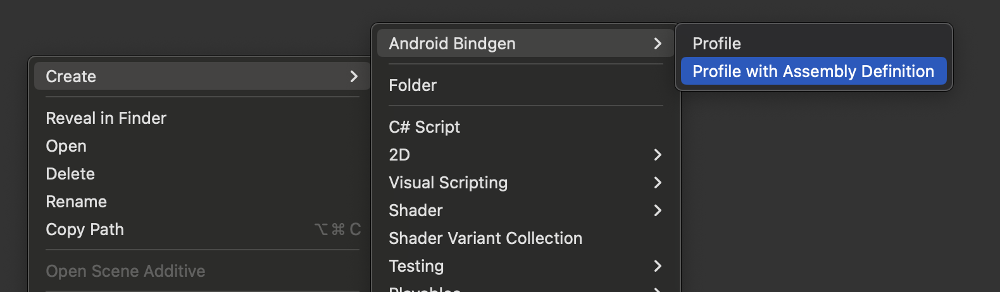
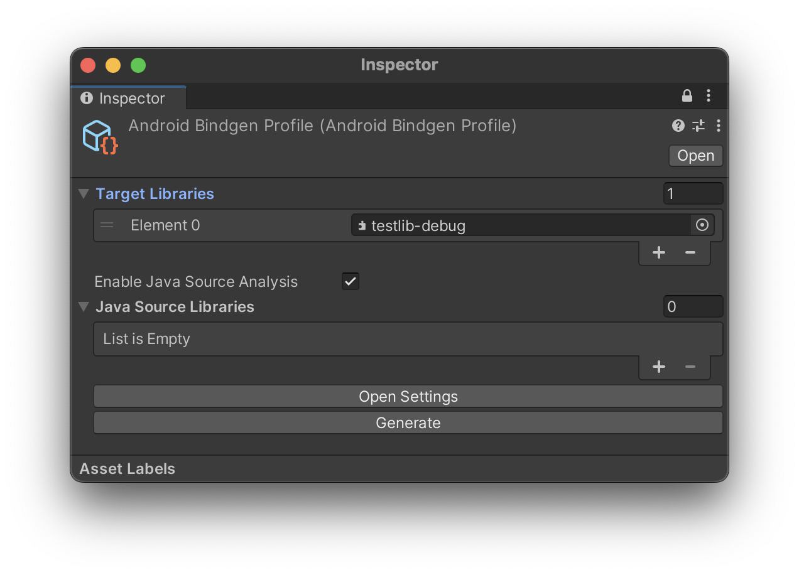
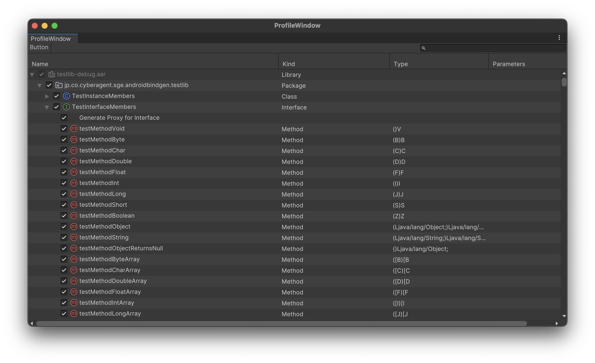

# AndroidBindgen

[](LICENSE)
[](https://github.com/CyberAgentGameEntertainment/AndroidBindgen/pulls)
[](#installation)

[日本語](README.ja.md)

A tool that automatically generates bindings for Android (Java) native calls in Unity.
It generates more performant code than just using `AndroidJavaObject` or `AndroidJavaProxy`.

<!-- TOC -->
* [AndroidBindgen](#androidbindgen)
  * [Requirements](#requirements)
  * [Installation](#installation)
    * [1. Install Dependencies](#1-install-dependencies)
    * [Install AndroidBindgen](#install-androidbindgen)
  * [Usage](#usage)
  * [About Generated Bindings](#about-generated-bindings)
    * [Upcasting](#upcasting)
    * [Downcasting](#downcasting)
    * [Proxy](#proxy)
  * [Generation from CLI](#generation-from-cli)
  * [License](#license)
<!-- TOC -->

## Requirements

- Unity 2022.3 or later

## Installation

### 1. Install Dependencies

Install the following packages using [NuGetForUnity](https://github.com/GlitchEnzo/NuGetForUnity) or [UnityNuGet](https://github.com/bdovaz/UnityNuGet):

- [System.Runtime.CompilerServices.Unsafe](https://www.nuget.org/packages/system.runtime.compilerservices.unsafe/)

### 2. Install AndroidBindgen

Add the following git URL to the Package Manager:

```
https://github.com/CyberAgentGameEntertainment/AndroidBindgen.git?path=AndroidBindgen.Unity/Packages/jp.co.cyberagent.android-bindgen#release
```

## Usage

Select `Create > Android Bindgen > Profile with Assembly Definition` in the folder where you want to generate bindings.



In the Inspector of the generated `AndroidBindgenProfile`, specify the `*.jar` or `*.aar` files you want to generate bindings for in the **Target Libraries** field. **If the target library depends on other libraries, include all of them.**
Also, if you enable **Enable Java Source Analysis**, you can extract documentation comments and some parameter names from Java sources. Specify `sources.jar` containing Java sources in the **Java Source Libraries** field.

> [!NOTE]
> `android.jar`, `android-stubs-src.jar` containing its sources, and Unity's `classes.jar` are automatically selected from those installed in your Unity editor, so manual specification is not required.

> [!WARNING]
> Java is required for Java source analysis.
> Java source analysis takes time, so disable it if not needed.



Next, click `Open Settings` to open the Profile Window. In this window, select the targets for binding generation:

- Methods: Generate method bindings.
- Fields: Generate field bindings.
- `Generate Proxy for Interface`: Generate base classes for creating proxies for interfaces.



> [!NOTE]
> Methods named `<init>` represent constructors.

Once selected, click `Generate` to generate the bindings. Bindings are output to the `generated` folder. Note that files in this folder may be automatically deleted or overwritten.

## About Generated Bindings

For each Java type, a binding interface is generated on the C# side.

To create Java objects from constructors, use the static method `New` defined in each interface:

```cs
java.util.ArrayList list = java.util.ArrayList.New(10);
```

> [!NOTE]
> Java package names are directly reflected as C# namespaces.

You can also create instances of binding objects from external JNI object pointers:

```cs
java.util.ArrayList list = java.util.ArrayList.FromRawObject(ptr);
```

Additionally, binding objects may be returned as method return values:

```cs
java.lang.Object element = list.get(0);
```

> [!NOTE]
> Due to type erasure, all type parameters are treated as `java.lang.Object`.

Binding objects obtained through these methods inherit from `AndroidJavaObject` and can be safely cast:

```cs
var list = java.util.ArrayList.New(10);
var obj = list as AndroidJavaObject;
```

### Upcasting
The inheritance relationships of binding interfaces reflect the Java class hierarchy, allowing safe upcasting:

```cs
java.util.ArrayList list = new java.util.ArrayList();
java.util.Cloneable cloneable = list;
```

### Downcasting
Binding objects cannot be downcast in C#. Use `FromRawObject()` instead:

```cs
java.util.Cloneable cloneable = /* ... */;

// NG
// java.util.ArrayList list = (java.util.ArrayList) cloneable;
// java.util.ArrayList list = cloneable as java.util.ArrayList;

// OK
java.util.ArrayList list = java.util.ArrayList.FromRawObject(cloneable);
```

### Proxy

When generating bindings for Java interfaces, a proxy base class `ProxyBase` is generated for implementation on the Unity side. By inheriting from this class, you can safely override and implement the necessary members:

```cs
using android.app;
using android.content;
using android.os;
using com.unity3d.player;
using UnityEngine;

private void Start()
{
    using var powerManagerObj = UnityPlayer.get_currentActivity().getSystemService(Context.get_POWER_SERVICE());
    using var powerManager = PowerManager.FromRawObject(powerManagerObj); // Downcast

    // Create proxy
    var listener = new ThermalStatusChangedListener();

    // Register
    powerManager.addThermalStatusListener(listener);
}

// Implementation of OnThermalStatusChangedListener
private class ThermalStatusChangedListener : PowerManager.OnThermalStatusChangedListener.ProxyBase
{
    public override void onThermalStatusChanged(int arg0)
    {
        Debug.Log($"Thermal status changed: {arg0}");
    }
}

```

> [!NOTE]
> Creating proxies that implement multiple interfaces simultaneously is not supported.

## Generation from CLI

You can also generate bindings from the command line without going through Unity. This CLI tool is included in the `AndroidBindgen.Standalone` project.

> [!NOTE]
> AndroidBindgen.Standalone specifies binding generation targets at the class level. Unlike the Unity version, it does not support controlling individual members or proxy generation.

- `--jar`: Specify the path to the target jar files.
- `--classes`: Specify the target class names.
- `--source` *(optional)*: By specifying the source (.java files, sources jar, or directory containing sources) for the jar specified in `--jar`, you can use more accurate parameter names.
- `--ignore-deprecated` *(optional)*: Ignore deprecated methods and fields.

```
cd AndroidBindgen.Standalone

dotnet run -- --jar android.jar,classes.jar \
 --classes android/app/Activity,com/unity3d/player/UnityPlayer \
 --source android-stubs-src.jar \
 --ignore-deprecated
```

By specifying `android.jar` from the Android SDK and `classes.jar` from Unity, you can also generate bindings for classes like `UnityPlayer`. These can be obtained from the following directories:

- **android.jar**: `<unity dir>/PlaybackEngines/AndroidPlayer/SDK/platforms/android-<version>/android.jar`
- **classes.jar**: `<unity dir>/PlaybackEngines/AndroidPlayer/Variations/il2cpp/Release/Classes/classes.jar`

Also, for the `--source` option, you can specify `android-stubs-src.jar` as the sources jar corresponding to `android.jar`:

- **android-stubs-src.jar**: `<unity dir>/PlaybackEngines/AndroidPlayer/SDK/platforms/android-<version>/android-stubs-src.jar`

The code is output to `out` under the current directory.

## License

MIT License

Icons for Unity editor (`AndroidBindgen.Unity/Packages/jp.co.cyberagent.android-bindgen/AndroidBindgen.Editors/Icons`) are from [JetBrains Platform Icons](https://intellij-icons.jetbrains.design/) and they are licensed under Apache 2.0:

```
Copyright 2000-2022 JetBrains s.r.o. and contributors. Use of this source code is governed by the Apache 2.0 license.
```
